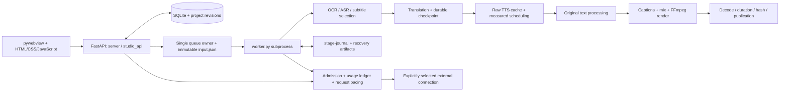

# NPK Auto Sub

**Ứng dụng Windows xử lý một video từ nhận dạng phụ đề tới dịch, lồng tiếng và xuất MP4.**

Kho này chứa bản mã nguồn phục vụ đọc, thảo luận và rà soát kiến trúc của **NPK Auto Sub 0.8.5 RC9**, kèm bản sửa tự bố trí lời đọc ngày 15/10/2026. Tên nội bộ trong một số module vẫn là **VietDub Studio** để giữ tương thích dữ liệu.

**Cập nhật 16/10/2026:** sửa API/JSON retry và ngữ cảnh dịch scope còn trống; thêm **Kiểm tra lời đọc** cục bộ để xem, chọn nhóm lặp hoặc dòng ghi nguồn cần tắt đọc. Giữ phần xóa vùng chọn. Xem [phạm vi, bằng chứng và giới hạn](docs/API-TRANSLATION-FOCUS-2026-10-16.md).

Đây là dự án đang phát triển, chưa phải sản phẩm đã nghiệm thu chất lượng hoặc bộ cài portable. Một video thực dài **11 phút 35 giây, 381 câu** đã đi hết pipeline và xuất được MP4; chất lượng timing/giọng vẫn có giới hạn được ghi rõ dưới đây. Số bài test không thay thế việc xem/nghe duyệt video.

## Đưa cho AI khác đọc

1. [Mô tả kiến trúc đầy đủ](docs/ARCHITECTURE.md): luồng xử lý, module, lưu trữ, API, checkpoint, kiểm quota và giọng.
2. [Hướng dẫn AI review + prompt bàn giao](docs/AI_REVIEW_GUIDE.md): thứ tự đọc, invariant cần giữ và câu hỏi cần phản biện.
3. [Cách thiết lập và chạy](docs/GETTING_STARTED.md).
4. [Trạng thái thực tế và giới hạn](docs/PROJECT_STATUS.md).
5. [Phạm vi bản public](docs/PUBLIC_SNAPSHOT.md), [ranh giới kiểm thử](docs/TEST-BOUNDARIES.md), [thành phần bên thứ ba](docs/THIRD_PARTY.md).

Prompt ngắn có thể gửi kèm link kho:

> Hãy đọc README.md, docs/ARCHITECTURE.md và docs/AI_REVIEW_GUIDE.md trước, rồi kiểm chứng các nhận định bằng mã nguồn. Tôi muốn phản biện cách chia trách nhiệm giữa UI, project settings, immutable job snapshot, checkpoint/journal, admission, API request budget/pacing, TTS cache, speech scheduling và render verification. Ưu tiên lỗi có thể làm gọi nhầm model, phát sinh nhiều request, mất phần đã hoàn tất, lệch giọng hoặc báo hoàn tất sai. Phân biệt đề xuất, test giả lập và bằng chứng chạy thật; đừng coi kiểm tra media thành công là đã xác nhận đủ chữ/phát âm đúng. Chưa được tự gọi API, tải model, sửa nội dung hay nới chính sách giọng khi chưa được yêu cầu.

Nếu AI không đọc được GitHub trực tiếp, dùng **Code → Download ZIP** rồi gửi ZIP mã nguồn cho AI đó. Kho công khai không bảo đảm mọi sản phẩm AI đều có công cụ đọc repository.

## Chức năng hiện có

| Nhóm | Hành vi |
|---|---|
| Dự án | Nhập video, lưu phiên bản, undo/redo, thay nguồn có kiểm soát, sao lưu/khôi phục dự án |
| Nhận dạng | OCR bằng RapidOCR hoặc ASR bằng faster-whisper; lưu phạm vi/bằng chứng và checkpoint |
| Chọn phụ đề | Tách lớp chữ, chọn track thủ công/tự động cục bộ; tùy chọn trợ giúp từ provider nhận hình |
| Dịch | Gemini, DeepSeek hoặc 9Router tương thích OpenAI; nhóm câu, kiểm phản hồi, giữ bản dịch và phần sửa tay |
| Phụ đề | Bảng song ngữ, thêm/chia/gộp câu, tìm-thay, kiểm chất lượng, SRT/ASS, font/style và chuyển cụm một dòng |
| Chữ gốc | Vùng che theo thời gian, box/blur/stretch/Telea/LaMa tùy runtime; xem thử trước khi chạy |
| Giọng | Piper và VieNeu cục bộ; chọn giọng từng câu/nhóm, lời đọc riêng, tốc độ, khoảng nghỉ và raw-audio cache |
| Tự bố trí lời đọc | Tùy chọn đo đủ mọi câu rồi xếp trong video, không chồng/cắt lời; giữ mốc phụ đề; tempo tối đa 1,25× |
| Âm thanh | Âm nguồn/giọng/nhạc nền, offset, normalize/ducking; tách nhạc tùy chọn khi đã cài runtime riêng |
| Tạo giọng độc lập | Văn bản → WAV/MP3 và thư viện bản đọc, không cần nhập video |
| Xuất | FFmpeg, H.264/AAC, CPU/NVENC tùy thiết bị; kiểm giải mã, thời lượng, hash và sao chép an toàn tới thư mục xuất |
| Phục hồi | Tiếp tục đúng bước còn thiếu qua owner, kiểm revision/source/checkpoint; không tự chạy lại OCR/dịch đã xong |

## Kiến trúc ở mức cao



Ứng dụng chạy backend trên **loopback**, có token phiên và khóa owner để tránh hai backend cùng điều khiển một hàng đợi. Worker đọc snapshot của lượt chạy. Thay cấu hình không được âm thầm đổi model của snapshot đang thực thi; hợp đồng được kiểm lại trước lần gửi API tiếp theo.

`data/` chứa SQLite, dự án, checkpoint, media kết quả và cache; API key được lưu qua Windows Credential Manager. **Kho này không chứa chúng.** Cấu hình model không phải bằng chứng quota đã phục hồi. Danh mục model, phép thử sinh nội dung và lưu token là các trạng thái khác nhau.

## Trạng thái và giới hạn đáng chú ý

- Ca chạy thực gần nhất: H.264 **1280×720**, AAC stereo **48 kHz**, **695,369 giây**, 381 câu dịch; đã giải mã kiểm tra **20.859 khung hình** của bản cuối và đối chiếu hash bản xuất.
- Raw speech dài **793,83 giây**. Bản tự bố trí sử dụng tempo tối đa **1,25×**. Độ lệch bắt đầu lời đọc lớn nhất khoảng **10,81 giây**; mục tiêu giảm lệch tới 2 giây không phải bảo đảm cứng.
- 167 câu có mốc từ qua forced alignment; 214 câu dùng mốc ước lượng. `lexical_verification` vẫn là `unverified`: có âm thanh/đủ thời lượng không chứng minh từng từ được phát âm đúng.
- Màu chữ, OCR, dịch, inpainting và lựa chọn lớp chữ vẫn cần bộ ca đánh giá đa dạng và người dùng duyệt. Blur là làm mờ vùng chữ, không phải tái tạo nền hoàn hảo.
- Source vẫn có các module lớn, nhiều thế hệ UI và một số script thử nghiệm lịch sử; cần tách trách nhiệm và cải thiện khả năng cài đặt lại trên máy sạch.
- Scheduler cục bộ điều phối request của NPK, không kiểm soát ứng dụng khác đang dùng chung 9Router hay quota của nhà cung cấp.
- Mã gắn monitor bảo vệ dự án có một ID mẫu đã ẩn danh trong bản public; cần tổng quát hóa cấu hình này nếu phát triển thành sản phẩm nhiều người dùng.

## Chạy từ mã nguồn

Yêu cầu nền: **Windows 11 x64, Python 3.12, WebView2, FFmpeg/ffprobe**. Chức năng AI cần model/runtime tương ứng; chúng không nằm trong Git. Xem [GETTING_STARTED](docs/GETTING_STARTED.md) trước khi cài hoặc chạy.

```powershell
git clone https://github.com/phuognkiet-max/npk-auto-sub.git
cd npk-auto-sub
py -3.12 -m venv runtime\venv
.\runtime\venv\Scripts\python.exe -m pip install -r requirements.txt
# Chuẩn bị FFmpeg, model/runtime theo hướng dẫn rồi mới chạy:
.\runtime\venv\Scripts\python.exe app.py
```

Lệnh trên là thiết lập phát triển, chưa phải cam kết một lệnh cài đủ mọi engine. Script `setup.ps1` có bước tải PyTorch và model khá lớn; đọc script trước khi chủ động chạy.

## Kiểm thử an toàn

```powershell
.\runtime\venv\Scripts\python.exe tools\run_tests.py --pattern test_speech_auto_schedule.py
.\runtime\venv\Scripts\python.exe tools\run_tests.py --profile media --pattern test_speech*.py
```

Runner tạo DATA riêng và chặn vault/mạng/inference ngoài profile. Một số bài cần fixture tổng hợp trong `tests/fixtures`; tạo bằng `tools/make_review_fixtures.py` khi đã có FFmpeg. Không chạy trực tiếp script nghiệm thu lịch sử lên dữ liệu người dùng. Xem [TEST-BOUNDARIES](docs/TEST-BOUNDARIES.md).

## Phạm vi chia sẻ và giấy phép

Đây là source snapshot được chọn bằng allowlist, không phải bản sao toàn bộ máy làm việc. Không có key, SQLite, video người dùng, giọng cá nhân, model weights, runtime, hồ sơ trình duyệt, hội thoại hay binary launcher. `PUBLIC_SOURCE_MANIFEST.json` ghi các file nguồn được chọn và các chuẩn hóa dùng cho bản public.

Chủ dự án **chưa chọn giấy phép open source riêng cho mã first-party**. Công khai để đọc/thảo luận không có nghĩa toàn bộ dependency, model và giọng được cấp lại cùng một giấy phép. Xem [LICENSE_STATUS](LICENSE_STATUS.md) và [THIRD_PARTY](docs/THIRD_PARTY.md).
